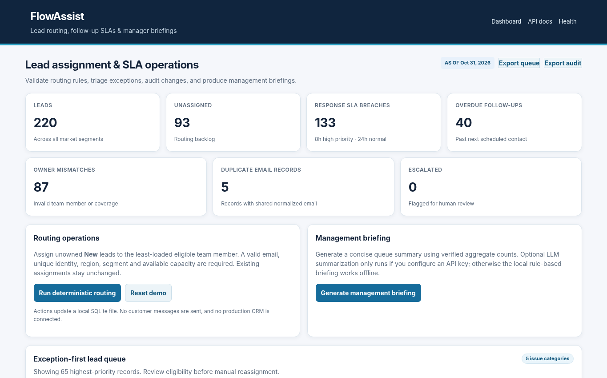

# FlowAssist — Rule-Based Lead Routing, SLA Triage & AI Briefings

> **Revenue operations • Sales automation • Lead governance • Human-in-the-loop**  
> An independent portfolio project by **Suhas Ramachandra**. Built to demonstrate early-career sales/revenue operations analytics capabilities.



**Business challenge.** Sales operations teams need consistent lead ownership, fast follow-ups, auditable rerouting decisions, and rapid management updates that do not overwrite legitimate CRM activity.

## What this application does

- Apply a deterministic territory + segment assignment rule to eligible unowned New leads
- Balance routing by current assigned workload and explicit rep capacity; reject duplicate identities or incomplete lead records
- Flag response SLA breaches, overdue follow-ups, ownership mismatches and duplicate contact records
- Support manual reassignment with server-side eligibility validation and one-click escalation
- Persist the lead queue and all routing/escalation actions in SQLite with exportable audit logs
- Generate management briefings from verified aggregate facts: offline rule-based text always works; optional API-backed LLM summarization with a user key

## Quick start

**Requirements:** Python 3.10+ and pip. Works locally on Windows, macOS and Linux. No database server and no external account are required for the core demo.

```bash
# In this repository folder
python -m venv .venv
# macOS/Linux:
source .venv/bin/activate
# Windows PowerShell:
# .venv\Scripts\Activate.ps1
pip install -r requirements.txt
python run.py
```

Open **http://127.0.0.1:8012** in your browser. To stop the server, press Ctrl+C.

### Run the tests

```bash
python -m pytest -q
```

### Regenerate the demo data

```bash
python data/generate_data.py
```

### Optional LLM management briefings

The entire app works offline with a clearly labeled **rules-based** briefing. To enable a real LLM-generated summary:

```bash
pip install -r requirements-ai.txt
# Supply OPENAI_API_KEY via your shell/environment (never commit it)
# Optional: OPENAI_MODEL to select your accessible model
python run.py
```

Only **aggregated counts and the fixed demo date** are supplied to the model. Raw lead identities are not sent. LLM responses are not used for routing and should be reviewed.

## Walkthrough for reviewers

1. Inspect the exception-first queue and note the response SLA and ownership mismatch counts.
2. Click **Run deterministic routing**; verify the unassigned count drops and new audit entries appear; run it again to confirm no duplicate routing.
3. Escalate a problematic lead, assign an eligible representative, export the audit, and generate the offline management briefing. Use **Reset demo** to restart.

## Design and data

- **Data:** 220 synthetic leads, six representative team profiles, territory and segment eligibility, intentionally incomplete/duplicate records.
- **Stack:** FastAPI, Python, SQLite, JSON routing rules, pytest, HTML/CSS; optional OpenAI API via `requirements-ai.txt`
- **Architecture:** [docs/architecture.md](docs/architecture.md)
- **Definitions and caveats:** [docs/metric_definitions.md](docs/metric_definitions.md)
- **Interview-ready case study:** [docs/project_story.md](docs/project_story.md)
- **API reference:** http://127.0.0.1:8012/docs (while server is running)

## Repository layout

```text
src/                Business logic + HTTP routes
data/               Deterministic synthetic data generator and raw CSV files
templates/          Interactive dashboard pages
static/             CSS + bundled Plotly JavaScript (no CDN required)
tests/              Automated behavior and regression checks
docs/               Architecture, data definitions, interview notes, screenshot
runtime/            Local state/output, intentionally excluded from Git
run.py              Starts the local web application
requirements.txt    Python dependencies
```

## Limits and interpretation

No real lead messages, email sending, production CRM mutations or PII; assignment rules intentionally simplified; the LLM is optional and is never responsible for routing. All activity is simulated at a fixed scenario date.

This project is a **simulated portfolio implementation** and does not represent an employer deployment, business cost saving or private client data. The code is intended as a reproducible showcase. The app binds to `127.0.0.1` for local development and has no authentication; **do not deploy publicly without authentication and security hardening**.

## Project credit

**Created for Suhas Ramachandra's analytics portfolio.** MIT License. These synthetic scenarios and repository assets are original artifacts created for this portfolio; technical methods are common industry practices.
