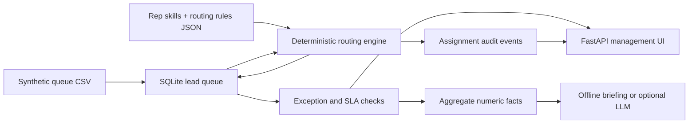

# Architecture and business rules

### Routing and safety design

Auto-routing affects only unowned `New` leads with an email that is not shared with another lead. Matching requires both regional and segment eligibility, capacity and deterministic lowest-load selection. Existing owners are never overwritten by the automatic process. Users can manually reassign only to an eligible rep; a SQLite audit record logs every change.

The auto-router flags, but does not attempt to fix, existing incorrect assignments. The optional LLM receives aggregate counts and is read-only; operational decisions remain deterministic and auditable. No outbound emails/calls or live CRM writes occur.

### Reproducibility

All data are fabricated using a fixed pseudo-random seed. The fixed sample-clock avoids misleading changes in SLA figures when a reviewer opens the project later. No personally identifying records from a real company are included.
